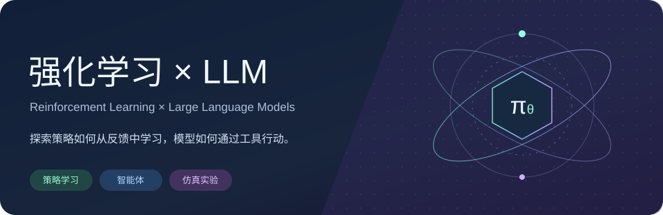
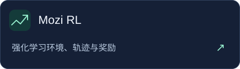
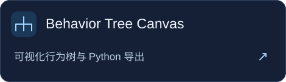

<p align="center">
  
</p>

<p align="center">
  <a href="#research-interests">研究兴趣</a> ·
  <a href="#selected-projects">项目实验场</a> ·
  <a href="https://github.com/abotang?tab=repositories">全部仓库 ↗</a>
</p>

### Hi, I'm abotang 👋

我喜欢研究**强化学习与 LLM**。对经典 RL 里的价值、策略与奖励保持好奇，也在探索大模型如何借助工具、记忆与环境反馈完成任务。

这里记录一些从想法到实现的尝试：搭环境、编排行为、连接模型，再把过程做成能看懂、能调试的工具。

<a id="research-interests"></a>

### 01 / 研究兴趣

| 方向 | 我感兴趣的问题 |
| :--- | :--- |
| **🧠 强化学习** | 从价值函数、策略迭代到探索与利用，理解策略究竟怎样学会行动。 |
| **⚡ Agent × LLM** | 让模型通过任务拆解、工具调用、状态记忆与执行反馈完成更长的任务。 |
| **🧪 仿真与实验** | 把环境、观测、动作、奖励和轨迹串起来，让想法有可检验的落点。 |
| **🕸️ 可视化工具** | 把行为树、执行过程和抽象结构变成可观察、可操作的界面。 |

<a id="selected-projects"></a>

### 02 / 项目实验场

<p>
  <a href="https://github.com/abotang/mozi"></a>
  <a href="https://github.com/abotang/Mozi-Agent"></a>
</p>
<p>
  <a href="https://github.com/abotang/Visual-Behavior-Tree"></a>
  <a href="https://github.com/abotang/Geometer-s-Sketchpad"></a>
</p>

### 03 / 从想法到行动

```text
                       ┌─────── feedback ───────┐
                       ↓                        │
 Environment ──→ Observation ──→ Policy / Agent ──→ Action
       │                                ↑
       └──── trajectories & rewards ─────┘
```

**项目里用到的工具** · Python / TypeScript / JavaScript / React / React Flow / PowerShell

对强化学习、智能体或仿真工具有想法，欢迎在对应项目的 Issues 里交流。

<p align="center"><sub>保持好奇，动手实验。<br/>Understand the policy. Build the agent. Run the experiment.</sub></p>
