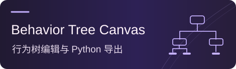
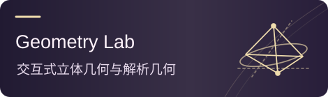

  

  

### 项目实验场

  
  

  
  

### 我在探索的问题

- **策略学习** · 如何设计观测与奖励，从仿真轨迹判断策略有没有学到预期行为？
- **智能体** · 如何让模型调用工具，再根据执行结果调整下一步？
- **可视化** · 如何把决策和执行过程变成容易检查、容易调试的界面？

[浏览全部公开仓库 ↗](https://github.com/abotang?tab=repositories)
